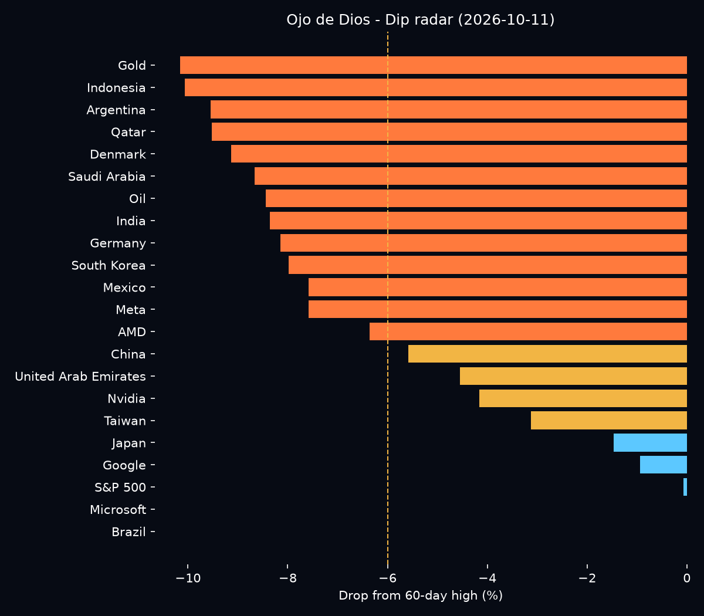

# Ojo de Dios — The Self-Feeding Global Portfolio

A Python robot that watches **22 markets across the Americas, Europe, Asia and the Middle East** every day and manages a **simulated long-term portfolio** with real market data. The goal is a robot with a truly **global reach**: more markets are added over time until it covers almost the whole world.

It never sells. It buys more when a market drops, adds a monthly contribution, and feeds its own dividends back into the weakest market — a **self-feeding** loop, like an eye watching the whole world at once.

> Simulation only. No real money is invested. Not investment advice.



## What it does

Every time it runs, the robot:

1. **Downloads real closing prices** for 22 assets with `yfinance`, plus the EUR/USD exchange rate.
2. **Loads its memory** (`portfolio.json`), or creates a new portfolio on the first run: €300, with €10 bought in every asset.
3. **Adds a monthly contribution** of €30 on the first run of each month.
4. **Buys the dip:** any market 6% or more below its 60-day high gets a €10 purchase, deepest drop first, with a 14-day cooldown per market.
5. **Collects dividends** (minus 15% withholding tax) and **feeds them back into the weakest market** — the self-feeding loop.
6. **Saves** the portfolio, a daily history (`history.csv`) and two charts.

Every purchase pays a 0.15% currency exchange fee, so the simulation includes trading costs.

## The self-feeding loop

The core idea of Ojo de Dios is that **the portfolio feeds itself**:

```
   markets pay dividends
            │
            ▼
   the robot collects them
            │
            ▼
   it finds the market that fell the most
            │
            ▼
   it feeds the dividends back in there
            │
            ▼
   that market grows inside the portfolio
   and pays more dividends later ──┐
            ▲                      │
            └──────────────────────┘
```

The money the portfolio earns goes back into the portfolio, always where prices are lowest. No new money is needed for this loop: it runs by itself, every day.

## Markets watched

| Region | Assets |
|---|---|
| United States | Nvidia, Microsoft, Google, Meta, AMD, S&P 500 |
| Asia | Japan, India, Indonesia, South Korea, China, Taiwan |
| Middle East | Saudi Arabia, United Arab Emirates, Qatar |
| Latin America | Brazil, Mexico, Argentina |
| Europe | Germany, Denmark |
| Commodities | Gold, Oil |

Country markets are tracked through US-listed ETFs (for example `EWJ` for Japan and `ARGT` for Argentina).

## Charts

- `dip_radar.png` — how far each market is below its 60-day high. Orange = buy zone, yellow = watch, blue = calm.
- `portfolio_value.png` — portfolio value over time (appears after 2 days of history).

## How to run it

```bash
pip install -r requirements.txt
python robot.py
```

Run it once per trading day. The robot remembers everything between runs.

## Project structure

```
robot.py           # the robot
requirements.txt   # libraries needed
portfolio.json     # memory (created on the first run)
history.csv        # daily portfolio value (created on the first run)
```

## Built with

Python · pandas · yfinance · matplotlib · JSON · CSV

## Roadmap

- [x] Real market data for 22 assets
- [x] Buy-the-dip rule with cooldown and trading fees
- [x] Memory, monthly contributions and self-feeding dividends
- [x] Daily history and charts
- [ ] Cover more of the world: more markets in Europe, Asia, Oceania, Africa and the Americas, plus more commodities
- [ ] 60-day evaluation: buy-the-dip vs. buy-and-hold
- [ ] Interactive "Ojo de Dios" dashboard (Streamlit)
- [ ] Deep learning model (PyTorch) that estimates whether a market will rebound after a drop, compared honestly against the fixed rules

## Author

Dalma Quiroga — Dublin, Ireland

The concept, name and design of "Ojo de Dios" are my own original work.

## License

Copyright © 2026 Dalma Quiroga. All rights reserved.
This code is shown for portfolio purposes only and may not be copied or reused
without written permission. See the [LICENSE](LICENSE) file.
